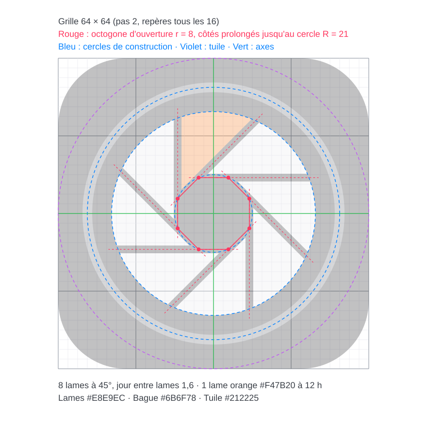

# Logo RCP For All Camera


Fichiers :

| Fichier | Usage |
|---|---|
| [internal/gui/brand/logo.svg](../../internal/gui/brand/logo.svg) | Icône de l'app : la marque sur sa tuile graphite (fenêtre, barre de titre, barre des tâches) |
| [internal/gui/brand/mark-dark.svg](../../internal/gui/brand/mark-dark.svg) | Marque seule, sur fond sombre |
| [internal/gui/brand/mark-light.svg](../../internal/gui/brand/mark-light.svg) | Marque seule, sur fond clair (lames graphite) |
| [logo-construction.svg](logo-construction.svg) | Dessin de construction (grille, cercles, tracés) |
| [gen_logo.py](gen_logo.py) | Le générateur : toutes les cotes sont dedans. On modifie le script, jamais les SVG à la main |

```bash
python docs/brand/gen_logo.py   # depuis la racine du dépôt
```

## L'idée

Le logo est un **iris de caméra à 8 lames**, dont **une seule est orange**, entouré d'une **bague**.

- **L'iris**, c'est ce que pilote un RCP. Toutes les marques (Blackmagic, Sony, Panasonic)
  ont un diaphragme : c'est le réglage commun à toutes les caméras, le « For All ».
  C'est aussi le geste principal de l'opérateur sur le Micro Camera Panel : le levier d'iris.
- **8 lames = les 8 boutons caméra** du panneau (Cam1 à Cam8, les 8 emplacements de l'app).
- **Une lame orange = la caméra sélectionnée.** C'est l'orange de sélection de l'app
  (`style.Accent`, `#F47B20`) et la couleur du bouton caméra actif sur le panneau. Les
  7 autres lames attendent : on pilote une caméra à la fois, parmi toutes.
- **La bague** autour des lames évoque la bague de master black qui entoure le levier
  d'iris sur le panneau, et la bague d'un objectif. Elle tient l'ensemble : un seul
  pupitre autour de toutes les caméras.
- **L'ouverture octogonale** au centre est la lumière qui passe : la caméra « ouverte »
  à l'opérateur.

Les couleurs sont celles de l'interface : graphite (`Surface`), gris clair (`Text`),
gris de bague (`TextFaint`) et l'orange de sélection. Le logo ne dit rien d'une marque de
caméra en particulier, et ne reprend aucun logo existant.

## Construction



Tout est dessiné sur une **grille de 64 × 64** unités, centre `(32, 32)`.

1. **Tuile** : carré 64 × 64, rayon d'angle **14**, couleur `#212225`. Elle est dessinée
   comme un chemin (arcs) et non `<rect rx>`, que le moteur SVG de Fyne ignore.
2. **Bague** : cercle de rayon **26**, trait **2**, couleur `#6B6F78`, sans remplissage.
   Marge de 5 unités entre la bague et le bord de la tuile.
3. **Ouverture** : octogone régulier inscrit dans un cercle de rayon **r = 8**. Son premier
   sommet est à −112,5° (soit −90° − 22,5°), ce qui met une lame pleine à 12 h.
4. **Lames** : on prolonge chaque côté de l'octogone (tracés rouges) jusqu'au cercle de
   **R = 21**. Deux côtés consécutifs et l'arc de cercle entre eux délimitent une lame :
   chaque lame est un triangle dont la pointe est un sommet de l'octogone et dont le
   grand côté est un arc. 8 lames, une tous les **45°**.
5. **Jours entre lames** : chaque côté est décalé vers l'intérieur de sa lame de
   **0,8** (jour total de **1,6**). La pointe de la lame devient l'intersection des deux
   côtés décalés, ce qui agrandit très légèrement l'ouverture. Les jours sont de vrais vides
   (pas un trait de la couleur du fond) : la marque fonctionne sur n'importe quel fond.
6. **Couleurs** : 7 lames `#E8E9EC`, la lame de 12 h en `#F47B20`.
   Version claire : lames `#2B2D31`, bague `#7A7F89`, lame orange inchangée.

Rapports à garder si on redessine : R/r ≈ 2,6 (au-dessous, l'iris paraît fermé et se
bouche en petit ; au-dessus, les lames deviennent des fils), bague = R + 5, trait de bague
≈ jour entre lames.

## Règles d'usage

- **Taille minimale** : 16 px (icône de fenêtre). En dessous de 24 px, préférer la tuile à la
  marque seule : le fond graphite garde le contraste des lames.
- **Zone de protection** : 1/8 de la largeur autour de la tuile (8 unités sur 64).
- **Une seule lame orange**, toujours à 12 h. Ne pas animer la couleur sur une autre lame,
  ne pas colorer plusieurs lames : l'orange veut dire « la caméra sélectionnée ».
- Ne pas déformer, ne pas tourner (la lame orange quitterait 12 h), ne pas ajouter d'ombre
  ni de dégradé, ne pas remplacer l'orange par le rouge du tally (`#CC2621`) : le rouge veut
  dire « à l'antenne ».
- Le nom s'écrit **RCP For All Camera**, à droite de l'icône, dans la police de l'interface,
  en gras.
